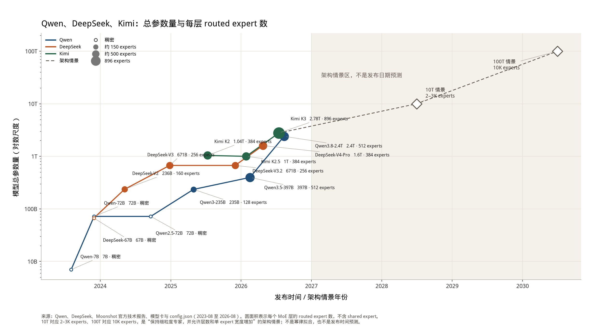

# Qwen, Kimi, and DeepSeek Scaling Trend

This note records how total parameter count and per-layer routed-expert count have changed across the Qwen, Kimi, and DeepSeek flagship models. Mooncake capacity planning depends on both quantities: total parameters set the weight footprint, and expert granularity sets the expert-parallelism domain needed to keep decode compute busy.

The figure below uses a logarithmic vertical axis. Marker area is the number of routed experts in one MoE layer. Shared experts are not included. Hollow markers are dense models. The shaded region and diamond markers are architecture scenarios, not predicted release dates.



{download}`Download the PDF figure <../image/qwen-kimi-deepseek-scaling.pdf>`

## Observed flagship models

| Date | Model | Total parameters | Routed experts per layer | Experts activated per token |
| --- | --- | --- | --- | --- |
| 2023-08 | Qwen-7B | 7B | dense | — |
| 2023-11 | Qwen-72B | 72B | dense | — |
| 2023-11 | DeepSeek-LLM-67B | 67B | dense | — |
| 2024-05 | DeepSeek-V2 | 236B | 160 | 6 |
| 2024-09 | Qwen2.5-72B | 72B | dense | — |
| 2024-12 | DeepSeek-V3 | 671B | 256 | 8 |
| 2025-04 | Qwen3-235B-A22B | 235B | 128 | 8 |
| 2025-07 | Kimi K2 | 1.04T | 384 | 8 |
| 2025-12 | DeepSeek-V3.2 | 671B | 256 | 8 |
| 2026-01 | Kimi K2.5 | 1T | 384 | 8 |
| 2026-02 | Qwen3.5-397B-A17B | 397B | 512 | 10 routed + 1 shared |
| 2026-04 | DeepSeek-V4-Pro | 1.6T | 384 | 6 |
| 2026-07 | Kimi K3 | 2.78T | 896 | 16 |
| 2026-08 | Qwen3.8-2.4T-A95B | 2.4T | 512 | 10 routed + 1 shared |

Dates are public release or technical-report months. Expert counts are routed experts in one MoE layer, taken from the corresponding model card or `config.json`.

## 10T and 100T scenarios

For an MoE model whose parameters are dominated by expert feed-forward weights:

```text
parameters ≈ layers × experts_per_layer × parameters_per_expert + shared weights
```

Holding layer count and expert width at the current flagship design gives these 10T expert counts:

| Anchor | Today | Same shape at 10T |
| --- | --- | --- |
| Qwen3.8-2.4T, 512 experts | 2.4T | about 2,100 |
| DeepSeek-V4-Pro, 384 experts | 1.6T | about 2,400 |
| Kimi K3, 896 experts | 2.78T | about 3,200 before extra depth |

The overlap is about 2,000–2,700 experts per layer, so the 10T marker uses 2–3K, with 2.5K drawn at the center. Qwen staying at 512 experts from 397B to 2.4T shows that parameter count alone does not determine the expert count. The 2–3K range assumes the current fine-grained expert size is kept.

A direct 10× scale from 10T / 2.5K experts would be 25K experts at 100T. The 10K marker instead assumes that depth and per-expert width together grow by 2.5×, for example 1.5× more layers and 1.67× more parameters per expert:

```text
experts(100T) ≈ 2.5K × 10 / 2.5 = 10K
```

That is an architecture choice, not a fit to the historical points. A power-law fit of the points already released extrapolates to roughly 1.3K experts at 10T and 4.5K at 100T.

Regenerate both files with `python3 docs/source/design/plot_model_scaling_trend.py` after installing `matplotlib`.

## Sources

- Qwen model cards and the Qwen3, Qwen3.5, and Qwen3.8 release notes.
- DeepSeek-V2, DeepSeek-V3, and DeepSeek-V4 technical reports, plus the V4 `config.json` (`n_routed_experts`).
- Kimi K2 and Kimi K3 technical reports. Kimi K2 is placed at its July 2025 technical report; the K3 report compares it with 384 routed experts.
